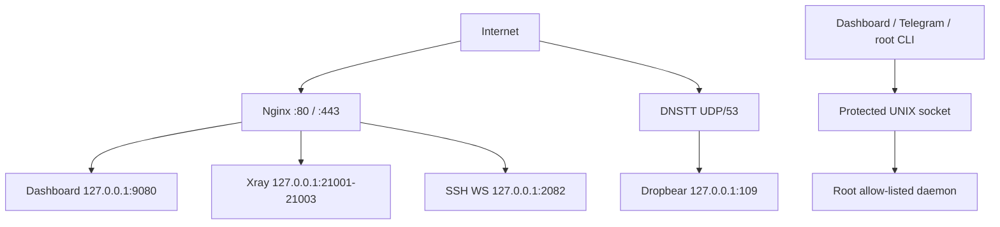

# Abdul Basit Secure VPS Panel v3.0.0

A security-focused Ubuntu/Debian control panel for SSH, VMess, VLESS, Trojan, Amazon CloudFront, Cloudflare, DNSTT + SSH, a TLS web dashboard, Telegram administration, real Xray traffic limits, and downloadable client profiles.

Repository: `drabkb786/secure-vps-panel`

## What v3 includes

| Area | Implementation |
|---|---|
| Protocols | SSH/Dropbear, VMess, VLESS and Trojan |
| Client access | Xray JSON with a local SOCKS5 listener, standard share links and WebSocket payloads |
| CDN | CloudFront CloudFormation template with an origin-verification secret; Cloudflare orange-cloud mode |
| Dashboard | TLS-only admin UI for users, limits, protocols, CDN, DNSTT and generated files |
| Limits | Account expiry for SSH/Xray; Xray per-user byte accounting and enforcement; SSH concurrent-session limits |
| DNSTT | Pinned upstream server, delegated DNS zone, encrypted DNSTT transport to loopback Dropbear |
| App exports | Open NetMod JSON, open DarkTunnel JSON, Xray JSON, share-link text and payload text |
| Telegram | Authorized admins can manage accounts and receive generated files directly |
| Safety | Root-owned state, unprivileged network services, loopback-only internals, atomic updates and rollback |

### Important scope and compatibility notes

- VLESS is the recommended default. Xray v26 still runs VMess, Trojan and WebSocket, but emits upstream deprecation warnings for them. They are present because this panel explicitly supports them.
- The data limit is real and enforced from Xray's per-user uplink/downlink counters. It covers VMess, VLESS and Trojan together.
- SSH and DNSTT use Linux account expiry and SSH session limits, but their bytes are **not** added to the Xray quota. The panel does not pretend that process I/O is network usage.
- NetMod and DarkTunnel do not publish a stable, open specification for their locked proprietary formats. The panel therefore creates auditable `.nm.json` and `.dark.json` profiles containing the Xray config, link and payload. It does not claim to create a proprietary encrypted/locked `.nm` or `.dark` file.
- For current NetMod releases, import the generated `*.xray.json` or standard link; NetMod's release notes document Xray JSON/link parsing. The `.nm.json` file is an inspectable companion profile, not a locked native `.nm` export. DarkTunnel's native `.dark` encoding is undocumented, so use the standard protocol link/manual import rather than treating `.dark.json` as a native encrypted file.
- Use this project only on servers and networks you own or are authorized to administer.

## Requirements

### Server

- Ubuntu 22.04/24.04+ or Debian 12+
- Python 3.10 or newer
- `x86_64`, `arm64`, or `armv7`
- Root access
- Recommended minimum: 1 vCPU, 1 GB RAM, 2 GB free disk
- A clean public VPS is strongly recommended
- Accurate UTC time, especially for VMess

The installer installs Nginx, Dropbear, Certbot, Fail2ban and other OS dependencies. It installs a checksum-pinned Xray release and builds a pinned DNSTT release with a checksum-verified Go toolchain.

### Domain and DNS

For normal TLS use, create an `A` record—and an `AAAA` record only if the VPS has working IPv6—pointing the panel hostname to the VPS. Example:

```text
vpn.example.com  A  203.0.113.10
```

DNS must resolve to the VPS before requesting a Let's Encrypt certificate.

### Firewall and provider security group

| Port | Protocol | Required for |
|---|---|---|
| 22 | TCP | VPS administration; keep this available during installation |
| 80 | TCP | ACME HTTP challenge and legacy SSH WebSocket route |
| 443 | TCP | TLS dashboard, direct Xray, Cloudflare and CloudFront origin |
| 109 | TCP | Direct Dropbear and DNSTT's loopback SSH target |
| 447 | TCP | Additional direct Dropbear port |
| 53 | UDP | DNSTT only |

Do **not** expose these internal ports publicly:

| Port | Purpose |
|---|---|
| 2082/TCP | Internal SSH WebSocket bridge |
| 9080/TCP | Internal dashboard HTTP server |
| 21001-21003/TCP | Loopback Xray WebSocket inbounds |
| 21085/TCP | Loopback Xray Stats API |

## Fresh installation

Keep an existing root/console session open while installing.

```bash
sudo -i
git clone https://github.com/drabkb786/secure-vps-panel.git
cd secure-vps-panel
bash install.sh --domain vpn.example.com --email admin@example.com
```

Then open the root menu:

```bash
menu
```

Non-interactive installation:

```bash
bash install.sh \
  --non-interactive \
  --domain vpn.example.com \
  --email admin@example.com
```

To omit the optional DNSTT build:

```bash
bash install.sh --domain vpn.example.com --email admin@example.com --skip-dnstt
```

The installer does not perform an unattended full OS upgrade and does not replace the administration service on port 22. It configures Dropbear separately on ports 109 and 447.

### Upgrade from v2

Back up `/etc/abdulbasit`, pull the new branch/release, and run the installer again. Existing SSH users remain SSH users. Enable VMess/VLESS/Trojan explicitly for accounts that need them.

```bash
sudo tar -C /etc -czf /root/abdulbasit-before-v3.tar.gz abdulbasit
git pull --ff-only
sudo bash install.sh --domain vpn.example.com --email admin@example.com
```

The backup contains credentials and must remain root-only.

## Initial setup

If installation was performed without a domain:

```bash
abdulbasit-panelctl set-domain vpn.example.com
abdulbasit-panelctl issue-cert --domain vpn.example.com
```

Configure the dashboard:

```bash
abdulbasit-panelctl configure-dashboard
```

Open:

```text
https://vpn.example.com/panel/
```

The dashboard service listens only on `127.0.0.1:9080`; Nginx is the only public entry point. Its password is PBKDF2-SHA256 hashed, sessions are signed and time-limited, mutations require CSRF tokens, and login failures are rate-limited.

Create a multi-protocol account from the dashboard, `menu`, Telegram, or the CLI:

```bash
abdulbasit-panelctl create-user alice \
  --days 30 \
  --sessions 2 \
  --quota 25 \
  --protocols ssh,vmess,vless,trojan
```

The CLI asks for the password without echoing it. The password is passed directly to `chpasswd`; it is not stored in panel metadata.

## Amazon CloudFront — priority setup

CloudFront support is implemented as WebSocket-over-HTTPS through a custom origin. The repository template uses:

- CloudFront's managed `CachingDisabled` policy;
- the managed `AllViewerExceptHostHeader` origin-request policy, which forwards WebSocket headers while replacing the origin `Host` correctly;
- HTTPS-only origin traffic;
- a secret custom origin header checked by Nginx on `/cloudfront/*` routes;
- the default `*.cloudfront.net` viewer certificate.

### CloudFront prerequisites

- An AWS account allowed to create CloudFront distributions and CloudFormation stacks
- AWS CLI credentials if deploying from a terminal
- A public, TLS-enabled VPS origin hostname
- TCP/443 open from the internet to the origin

Use a DNS-only origin hostname when possible. Example: `origin-vpn.example.com` points directly to the VPS and is the panel domain. Do not place Cloudflare in front of this hostname when CloudFront is the intended outer CDN.

### 1. Install and verify origin TLS

```bash
abdulbasit-panelctl set-domain origin-vpn.example.com
abdulbasit-panelctl issue-cert --domain origin-vpn.example.com
curl -fsS https://origin-vpn.example.com/healthz
```

### 2. Generate an origin secret

The dashboard has a **Generate origin secret** button. From a shell:

```bash
cf_origin_secret="$(openssl rand -base64 48 | tr -d '\n=' | tr '+/' '-_')"
```

Keep this value private. The same value must be supplied to CloudFormation and the panel.

### 3. Deploy the distribution

From the repository directory:

```bash
aws cloudformation deploy \
  --stack-name abdulbasit-vpn-cloudfront \
  --template-file infra/cloudfront-websocket.yml \
  --parameter-overrides \
    OriginDomain=origin-vpn.example.com \
    OriginVerifySecret="$cf_origin_secret" \
    PriceClass=PriceClass_100
```

Read the generated CloudFront hostname:

```bash
cf_endpoint="$(aws cloudformation describe-stacks \
  --stack-name abdulbasit-vpn-cloudfront \
  --query 'Stacks[0].Outputs[?OutputKey==`CloudFrontDomain`].OutputValue' \
  --output text)"
printf '%s\n' "$cf_endpoint"
```

### 4. Connect the panel profile

```bash
abdulbasit-panelctl configure-cdn cloudfront \
  --endpoint "$cf_endpoint" \
  --origin origin-vpn.example.com \
  --secret "$cf_origin_secret"
```

Do not omit `--secret` after deploying the stack. If the panel generates a different value, update the CloudFormation stack with that exact new value.

The panel rejects this operation unless `--origin` exactly matches the configured panel domain and that domain already has installed certificate files. This prevents a parser-valid but unusable CloudFront origin profile.

The automated CloudFormation path accepts the generated `*.cloudfront.net` distribution hostname. Custom CloudFront aliases and ACM viewer certificates are not configured by this template.

### 5. Generate CloudFront client files

```bash
abdulbasit-panelctl generate-exports alice vless --provider cloudfront
abdulbasit-panelctl list-exports alice
```

CloudFront paths are deliberately separate:

```text
/cloudfront/vmess
/cloudfront/vless
/cloudfront/trojan
```

Direct routes remain `/vmess`, `/vless` and `/trojan`. Xray itself stays on loopback.

### 6. Verify CloudFront

CloudFront deployment can take several minutes. When its status is deployed:

```bash
curl -fsS "https://$cf_endpoint/healthz"
```

Then import the generated Xray JSON or share link and test its local SOCKS proxy. A `403` on a `/cloudfront/*` path normally means the CloudFormation and panel origin secrets do not match.

The template uses CloudFront's 60-second origin response timeout. A completely idle WebSocket can therefore be closed by the edge; clients should keep traffic alive or reconnect. Active tunnels continue while packets arrive within that interval.

To disable the panel's CloudFront profile without deleting the AWS distribution:

```bash
abdulbasit-panelctl remove-cdn cloudfront
```

Deleting the AWS stack is a separate AWS action and may stop active clients. It is not performed by the panel.

## Cloudflare setup

Cloudflare mode expects the panel hostname itself to be orange-cloud proxied. This keeps viewer and origin certificate names aligned.

1. Point `vpn.example.com` to the VPS.
2. Issue the origin certificate while DNS is direct if necessary.
3. Turn the Cloudflare proxy on for the record.
4. In Cloudflare, use SSL/TLS mode **Full (strict)** and leave WebSockets enabled.
5. Configure the same hostname as endpoint and origin:

```bash
abdulbasit-panelctl configure-cdn cloudflare \
  --endpoint vpn.example.com \
  --origin vpn.example.com
```

6. Generate a client:

```bash
abdulbasit-panelctl generate-exports alice vless --provider cloudflare
```

The panel rejects different Cloudflare endpoint/origin hostnames because the automated certificate and Nginx configuration cover one hostname. Advanced Cloudflare Origin Rules or multi-SAN certificate setups are outside this automated path.

For DNSTT records hosted in Cloudflare, the DNSTT nameserver `A`/`AAAA` record must be **DNS only**, not orange-cloud proxied.

## Protocol and user management

### Enable or disable protocols

```bash
abdulbasit-panelctl enable-protocol alice vless,trojan
abdulbasit-panelctl disable-protocol alice vmess
```

Disabling SSH locks the Linux password and ends managed Dropbear sessions. Enabling SSH unlocks it. Xray changes are rendered to a temporary file, validated by the real Xray binary, atomically installed, and rolled back if restart fails.

### Rotate an Xray credential

```bash
abdulbasit-panelctl rotate-protocol alice vless
abdulbasit-panelctl rotate-protocol alice trojan
```

Existing files contain the old credential. Generate new files after rotation.

### Renew time limit

```bash
abdulbasit-panelctl renew-user alice --days 30
```

SSH expiry is maintained through the Linux account. The one-minute usage/expiry timer removes expired Xray users from the active config.

### Set or reset data limit

```bash
abdulbasit-panelctl set-quota alice --quota 50
abdulbasit-panelctl set-quota alice --quota Unlimited
abdulbasit-panelctl reset-usage alice
```

The panel uses decimal gigabytes: `1 GB = 1,000,000,000 bytes`. VMess, VLESS and Trojan traffic for one user is aggregated under one Xray statistics identity. When usage reaches the limit, the user is removed from all Xray inbounds. Resetting usage restores eligible, unexpired profiles.

Counters use an idempotent pending journal while user files are updated. Once a reset result has been journaled, an interruption during persistence is replayed on the next run without counting an already-applied transaction twice.

### SSH session limit

```bash
abdulbasit-panelctl set-sessions alice --sessions 2
abdulbasit-panelctl list-sessions
```

This is a concurrent managed Dropbear process limit, not a unique-IP limit.

## Generated client files

```bash
abdulbasit-panelctl generate-exports alice vless --provider direct
abdulbasit-panelctl generate-exports alice vless --provider cloudfront
abdulbasit-panelctl list-exports alice
```

Each bundle contains five files:

| File | Purpose |
|---|---|
| `*.xray.json` | Complete Xray client with SOCKS5 on `127.0.0.1:10808` |
| `*.link.txt` | VMess, VLESS or Trojan share link |
| `*.nm.json` | Open NetMod-oriented profile with link, payload and Xray config |
| `*.dark.json` | Open DarkTunnel-oriented profile with link, payload and Xray config |
| `*.payload.txt` | WebSocket HTTP-upgrade payload for the authorized configured endpoint |

The payload is derived from the selected route; it is not a generic third-party host exploit. Example:

```text
GET /cloudfront/vless HTTP/1.1[crlf]Host: d123example.cloudfront.net[crlf]Upgrade: websocket[crlf]Connection: Upgrade[crlf][crlf]
```

Files are root-owned under `/etc/abdulbasit/exports/USER/`. Download/delete them from the dashboard, or let the authorized Telegram bot upload them directly as documents.

CLI file operations:

```bash
abdulbasit-panelctl get-export alice alice-vless-direct.xray.json
abdulbasit-panelctl delete-export alice alice-vless-direct.xray.json
```

`get-export` returns base64 in JSON; the dashboard and bot decode it for download.

## DNSTT + SSH

DNSTT needs a delegated subdomain and UDP/53 on a VPS IP. Example:

```text
tns.example.com  A   203.0.113.10
t.example.com    NS  tns.example.com
```

The nameserver hostname must be outside the tunnel zone: `tns.example.com` is valid for `t.example.com`; `ns.t.example.com` is not.

Configure the server:

```bash
abdulbasit-panelctl configure-dnstt \
  --zone t.example.com \
  --nameserver tns.example.com \
  --listen-ip 203.0.113.10 \
  --target-port 109
```

The command generates an encrypted DNSTT keypair, starts the unprivileged DNSTT service with only `CAP_NET_BIND_SERVICE`, and prints the required DNS records. It binds only the requested IP. A local resolver on `127.0.0.53:53` may coexist; a wildcard or same-IP UDP/53 listener must be stopped or moved.

Generate the user file:

```bash
abdulbasit-panelctl export-dnstt alice
```

The file includes the public key and client examples. After starting `dnstt-client`, connect an SSH client to `127.0.0.1:7000` using the managed SSH username/password. The DNSTT server forwards only to loopback Dropbear on port 109.

Check or disable:

```bash
abdulbasit-panelctl list-dnstt
abdulbasit-panelctl disable-dnstt
```

DNSTT transports SSH; therefore Linux expiry and the Dropbear session limit apply. DNSTT bytes are not part of the Xray quota.

## Telegram bot

Create a Telegram bot with BotFather, then configure it without putting the token on a command line:

```bash
abdulbasit-panelctl configure-bot
```

The CLI asks for the token with hidden input and for the numeric Super Admin ID. The bot runs as `abdulbasit-bot`, not root, and reaches privileged operations only through the panel's allow-listed UNIX socket API.

Telegram features include:

- create/delete/renew users;
- session and Xray data limits;
- protocol enable/disable/rotation;
- service and CDN status;
- generated Xray/NetMod/DarkTunnel/payload documents;
- DNSTT user document;
- Super Admin-managed admin IDs.

CloudFront origin secrets are intentionally configured through the TLS dashboard or root CLI, not sent through Telegram.

## CLI reference

```text
create-user USER --days N --sessions N --quota GB|Unlimited --protocols LIST
delete-user USER
renew-user USER --days N
set-sessions USER --sessions N
set-quota USER --quota GB|Unlimited
reset-usage USER
enable-protocol USER PROTOCOLS
disable-protocol USER PROTOCOL
rotate-protocol USER PROTOCOL
list-users
list-sessions

set-domain HOSTNAME
issue-cert [--domain HOSTNAME]
configure-cdn cloudfront|cloudflare --endpoint HOST --origin HOST [--secret SECRET]
list-cdn
remove-cdn cloudfront|cloudflare

generate-exports USER vmess|vless|trojan --provider direct|cloudfront|cloudflare
list-exports USER
get-export USER FILENAME
delete-export USER FILENAME

configure-dnstt --zone ZONE --nameserver HOST --listen-ip IP [--target-port 109] [--rotate-keys]
list-dnstt
export-dnstt USER
disable-dnstt

configure-dashboard
configure-bot
add-admin TELEGRAM_ID
remove-admin TELEGRAM_ID
list-admins
status
restart SERVICE
```

## Architecture and security model



Key controls:

- Xray, dashboard, Telegram and DNSTT have dedicated unprivileged service accounts.
- Xray protocol/API ports and the dashboard are loopback-only.
- The CDN origin secret and its generated Nginx config are root-only.
- Dashboard auth is readable only by the isolated dashboard group.
- User metadata and export files are root-only.
- Xray blocks private/reserved destinations and BitTorrent by default.
- Nginx configuration and Xray configuration are validated before reload/restart.
- State changes use file locking and atomic replacement.
- Linux username/domain/protocol/path/filename/CDN/DNSTT inputs are strictly validated.
- Subprocesses use argument arrays; the code rejects `shell=True`.

## Validation and tests

Repository checks:

```bash
python3 -m py_compile src/*.py scripts/*.py
bash -n install.sh menu.sh scripts/*.sh
node --check web/app.js
python3 scripts/static-audit.py
pytest -q
cfn-lint infra/cloudfront-websocket.yml
python3 scripts/validate-xray-configs.py
python3 scripts/live-xray-smoke.py
```

Runtime checks after installation:

```bash
xray run -test -config /etc/abdulbasit/xray/config.json
nginx -t
abdulbasit-security-check
systemctl --no-pager --full status \
  abdulbasit-paneld abdulbasit-xray abdulbasit-usage.timer nginx dropbear
```

The v3 implementation was also exercised with the pinned real binaries:

- Xray parsed the server config and all three generated client configs;
- VMess, VLESS and Trojan each carried a live HTTP request through the generated SOCKS client and WebSocket transport;
- the Xray Stats API query/reset command completed against a running server;
- the pinned DNSTT client/server carried an 8192-byte encrypted echo stream;
- the CloudFront template passed `cfn-lint`.

AWS credentials/distribution deployment and public DNS propagation are environment-specific and cannot be simulated by repository tests.

## Upstream references

- [AWS CloudFront WebSocket support](https://docs.aws.amazon.com/AmazonCloudFront/latest/DeveloperGuide/distribution-working-with.websockets.html)
- [AWS CloudFront custom origin headers](https://docs.aws.amazon.com/AmazonCloudFront/latest/DeveloperGuide/add-origin-custom-headers.html)
- [Xray API and statistics configuration](https://xtls.github.io/en/config/api.html)
- [Xray WebSocket transport](https://xtls.github.io/en/config/transports/websocket.html)
- [Official DNSTT documentation and source](https://www.bamsoftware.com/software/dnstt/)
- [NetMod official release files and notes](https://sourceforge.net/projects/netmodhttp/files/Setup/)

## Troubleshooting

### CloudFront returns 403

The origin secret in the panel and CloudFormation stack differs. Update one side so both use the exact same 24-128 character URL-safe value, then wait for the distribution update.

```bash
abdulbasit-panelctl list-cdn
journalctl -u nginx --no-pager -n 100
```

The public `list-cdn` output intentionally redacts the secret. Reconfigure both sides if it has been lost.

### CloudFront returns 502/504

- Verify the origin hostname resolves directly to the VPS.
- Verify its certificate is valid for the origin hostname.
- Confirm TCP/443 is open.
- Run `curl -fsS https://ORIGIN/healthz` outside CloudFront.
- Run `nginx -t` and inspect Nginx logs.

### Cloudflare 525/526

Use **Full (strict)** and ensure the origin certificate matches the orange-cloud hostname. The panel intentionally requires endpoint and origin hostname to match in automated Cloudflare mode.

### Xray config/restart failure

```bash
xray run -test -config /etc/abdulbasit/xray/config.json
journalctl -u abdulbasit-xray -u abdulbasit-paneld --no-pager -n 200
```

Panel changes roll back if Xray rejects a candidate config or restart fails. A pending marker causes the usage timer to retry synchronization.

### Usage does not increase

```bash
systemctl is-active abdulbasit-usage.timer
systemctl start abdulbasit-usage.service
journalctl -u abdulbasit-usage --no-pager -n 100
xray api statsquery --server=127.0.0.1:21085 -pattern 'user>>>'
```

Only Xray protocols count. SSH/DNSTT bytes will not appear.

### Dashboard shows 502

```bash
systemctl status abdulbasit-dashboard --no-pager
journalctl -u abdulbasit-dashboard -u abdulbasit-paneld --no-pager -n 100
abdulbasit-panelctl configure-dashboard
```

### DNSTT will not start

```bash
ss -lunp 'sport = :53'
abdulbasit-panelctl list-dnstt
journalctl -u abdulbasit-dnstt --no-pager -n 150
```

Check UDP/53 in both the VPS firewall and provider security group. Verify the `A`/`AAAA` nameserver record and `NS` delegation, and ensure the nameserver record is DNS-only in Cloudflare.

### Full health check

```bash
abdulbasit-security-check
abdulbasit-panelctl status
journalctl --no-pager -n 200 \
  -u abdulbasit-paneld \
  -u abdulbasit-xray \
  -u abdulbasit-usage \
  -u abdulbasit-dashboard \
  -u abdulbasit-dnstt \
  -u nginx
```

## Main files

| Path | Purpose |
|---|---|
| `/etc/abdulbasit/users/*.json` | Root-only user metadata and Xray credentials |
| `/etc/abdulbasit/xray/config.json` | Generated Xray server config |
| `/etc/abdulbasit/cdn.json` | Root-only CDN state/origin secret |
| `/etc/abdulbasit/dashboard_auth.json` | Dashboard password hash/session secret |
| `/etc/abdulbasit/dnstt.json` | DNSTT state |
| `/etc/abdulbasit/dnstt/` | DNSTT server keypair |
| `/etc/abdulbasit/exports/` | Generated client files |
| `/etc/nginx/conf.d/abdulbasit-vpn.conf` | Root-only generated Nginx config |
| `/usr/local/lib/abdulbasit/` | Installed Python application |
| `/usr/local/share/abdulbasit-dashboard/` | Dashboard static assets |

## Project ownership

Maintainer: Abdul Basit — GitHub: <https://github.com/drabkb786/secure-vps-panel>
